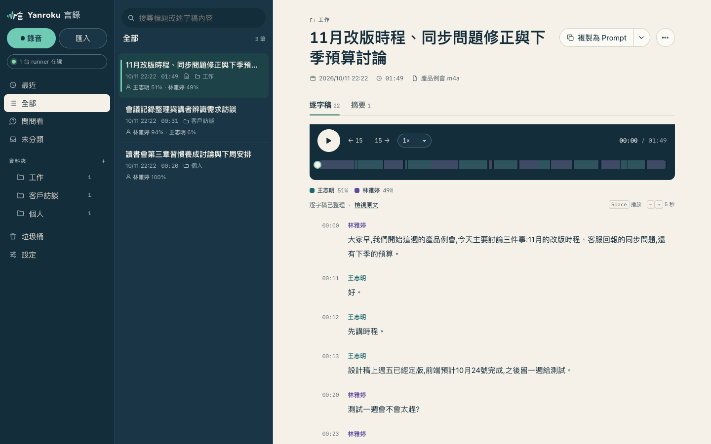

<div align="center">
  
  <h1>Yanroku 言錄</h1>
  <p><b>自己架的 AI 語音筆記：分講者的逐字稿與摘要</b><br>錄音存在你的 Cloudflare 帳號，轉錄在你的 Mac 上跑，摘要用你已經付費的 Claude Code 或 Codex 來寫。</p>
</div>

<p align="center">
  <a href="../LICENSE"></a>
  <a href="../runner/go.mod"></a>
  <a href="#架構"></a>
  <a href="#自架"></a>
</p>

<p align="center">
  <a href="../README.md">English</a> | 繁體中文
</p>



> 介面是繁體中文。摘要可以用繁體中文、英文或日文產生。

不想自己架伺服器？見 [Yanroku Cloud](#yanroku-cloud)。

## 為什麼

Plaud 這類錄音筆和筆記 App，錄音通常存在廠商的伺服器上，AI 功能還要另外訂閱。Yanroku 用你本來就有的東西做同一件事：Cloudflare 帳號存錄音、Mac 做轉錄、你已經付費的 Claude 或 ChatGPT 方案寫摘要。

- **儲存是你的**：音訊放在你自己的 R2 bucket，資料放在你自己的 D1，由你自己的 Cloudflare Access 把關登入。
- **硬體是你的**：語音轉文字在你的 Mac 上用 `whisper.cpp`（Metal）跑，除非你選 Groq。
- **AI 訂閱是你的**：逐字稿整理、標題、摘要和 Ask 透過 ACP 交給 Claude Code 或 Codex，不用 API key，不會多一張帳單。
- **程式碼是你的**：跑的東西全都在這個 repo 裡，以 AGPL-3.0 授權。

## 功能

| | |
|---|---|
| **錄音或匯入** | 在瀏覽器錄音（手機也行），或一次拖進多個音訊／影片檔。大檔分段平行上傳、失敗自動重試；在 Mac 上可用 `yanroku ingest <folder>` 批次上傳 |
| **分講者逐字稿** | 文字用 `whisper.cpp` 或 Groq Whisper，誰說了什麼用 `sherpa-onnx` 分辨。再由 AI 修正標點和明顯的辨識錯字 |
| **同步播放** | 點任一句就從那裡播放；進度條顯示每段是誰在說話 |
| **聲紋** | 講者只要命名一次（單句或全部）；之後的錄音會自動認出同一個人，把握不夠時會提示「可能是 X？」 |
| **摘要** | 依範本（會議摘要）產生，可選繁體中文、英文或日文，以 Markdown 呈現 |
| **問問看（Ask）** | 對所有錄音提問；回答會標出出自哪段錄音、哪個時間點，點一下就跳到那裡 |
| **資料夾、搜尋、垃圾桶** | 可巢狀的資料夾、搜尋標題與逐字稿內容、刪除後可還原 |
| **詞彙** | 一份詞彙表，用來引導辨識和整理；Yanroku 也會從你自己的修正中整理出建議詞彙，但不會自動加入 |
| **複製為 Prompt** | 把摘要和／或逐字稿（或選取的一段）複製成可貼到 ChatGPT 或 Claude 的 prompt，附長度估計，也可下載成 `.md` |
| **Runner 狀態** | 看得到哪幾台 Mac 在線、正在處理什麼、哪幾台還在跑舊版 |
| **Web Push** | 選配的「處理完成」通知（iOS 需要加入主畫面的網頁 App） |
| **iOS App** | [Yanroku App](https://yanroku.app) 可以連到你自己的伺服器（「連線到自己的伺服器」）。App 是另一個產品，這個 repo 是伺服器 |

支援淺色／深色主題，每個畫面都有自己的網址，寬度到 360 px 也能用。

## 用你自己的 AI 訂閱

逐字稿整理、標題、摘要、Ask 和詞彙建議，都透過 runner 那台 Mac 上的 [ACP](https://agentclientprotocol.com)（Agent Client Protocol）agent 來跑：

- **Claude Code**（預設）：`npm i -g @agentclientprotocol/claude-agent-acp && claude login`，再設 `ACP_AGENT=claude-agent-acp`。需要包含 Claude Code 的方案（Pro、Max 等）。
- **Codex**：`npm i -g @openai/codex && codex login`，再設 `ACP_AGENT=npx -y @zed-industries/codex-acp -c model=gpt-5.5`。需要 ChatGPT 方案。

語音轉文字（whisper.cpp 或 Groq）和分講者（sherpa-onnx）是另外的，不經過 Claude 或 Codex。逐字稿文字會送到你的 ACP agent 所使用的模型。細節與疑難排解見 [`SELF-HOST.md` 4.5](SELF-HOST.md#45-用你自己的-ai-訂閱claude-code-或-codex)。

## 架構

```
 瀏覽器 / iOS App ──▶ Cloudflare Worker (web/) ──▶ D1（資料）+ R2（音訊）
                         ▲  由 Cloudflare Access 保護
                         │  工作佇列（lease）
 Mac runner (runner/) ───┘  ffmpeg · whisper-cli · sherpa-onnx · ACP agent
```

| 路徑 | 內容 |
|---|---|
| `web/` | Cloudflare Worker，TypeScript，不用框架：API、靜態介面（`web/public/index.html`）、D1 migrations |
| `runner/` | 給 Apple Silicon Mac 的 Go 程式。向 Worker 領工作，在本機做重的處理，再把結果傳回去。多台 runner 可以共用同一個佇列 |
| `docs/SPEC.md` | Worker、網頁與 runner 之間的約定：schema、API、處理流程 |
| `docs/SELF-HOST.md` | 完整的自架指南 |

音訊存在你的 Cloudflare 帳號，在你的 Mac 上轉錄（除非你選 Groq）。

**安全性**：Worker 預設拒絕（fail closed）：沒設 `ACCESS_TEAM` / `ACCESS_AUD` 時，所有 API 都回 503，每個請求都會驗證 Cloudflare Access 的 JWT。資料表是多使用者設計（每一列都有 `user_id`，每個查詢都依它限定範圍，有雙使用者隔離測試涵蓋），但這個入口只認一個使用者：通過 Access 的人都是同一個使用者。其他登入方式可以透過 `createWorker` 接上（見 [`SPEC.md`](SPEC.md) 的 "Extending the server"）。

## 自架

**只用一台 Mac、不用 Cloudflare**：一個指令把網頁服務和 runner 一起跑起來，資料存在本機的 SQLite 和檔案（需要 Node.js 22.18 以上）：

```sh
git clone https://github.com/SammyLin/yanroku.git && cd yanroku/runner
brew install go ffmpeg whisper-cpp node
npm i -g @agentclientprotocol/claude-agent-acp && claude login
cp .env.example .env && ./deploy.sh    # 編譯、下載模型（約 1.5 GB）
./yanroku up                           # http://127.0.0.1:8780（要常駐：sh install-launchd.sh --local）
```

預設只聽 127.0.0.1；用 `--host 0.0.0.0`（或 `LOCAL_HOST`）開放給其他裝置時必須設 `LOCAL_PASSWORD`。詳見 [`docs/SELF-HOST.md` 第 0 節](SELF-HOST.md#0-最簡單本機模式不用-cloudflare)。

**架在 Cloudflare 上**（多台 Mac 分攤、在外面也能連、用 iOS App）：需要：網域放在 Cloudflare 上的 Cloudflare 帳號（建議 Workers Paid，CPU、D1、R2 額度都比較夠），以及一台能一直開著、裝了 Homebrew 的 Apple Silicon Mac。

完整步驟（D1/R2、為自己的部署加一個 wrangler `env`、Cloudflare Access 與每台 runner 一個 service token、用 launchd 常駐 runner、連上 iOS App）在 [`SELF-HOST.md`](SELF-HOST.md)。簡短版：

```sh
git clone https://github.com/SammyLin/yanroku.git && cd yanroku

# Worker：先在 web/wrangler.jsonc 加上你自己的 env（D1 id、R2 bucket、網域、ACCESS_TEAM、ACCESS_AUD）
cd web && npm install
npx wrangler d1 migrations apply <your-db> --remote --env mine
npx wrangler deploy --env mine

# Runner，每台 Mac 各做一次
brew install go ffmpeg whisper-cpp node
npm i -g @agentclientprotocol/claude-agent-acp && claude login
cd ../runner && cp .env.example .env   # API_BASE + 這台 Mac 的 Access service token
./deploy.sh                            # 編譯、下載模型（約 1.5 GB）、已安裝服務的話重啟
./yanroku run                            # 先在前景試跑
sh install-launchd.sh                  # 再裝成 launchd 服務
```

本機開發見 [`CLAUDE.md`](../CLAUDE.md)。

## 設定

**Runner**（`runner/.env`，見 [`runner/.env.example`](../runner/.env.example)；實際的環境變數優先於檔案）：

| 變數 | 預設 | |
|---|---|---|
| `API_BASE` | 無（必填） | 你的 Worker 網址；沒設 runner 不會啟動 |
| `CF_ACCESS_CLIENT_ID` / `CF_ACCESS_CLIENT_SECRET` | | 這台 Mac 的 Cloudflare Access service token |
| `RUNNER_NAME` | hostname | 顯示為工作的處理者，也出現在 runner 狀態 |

`API_BASE` 是必填，沒有預設值。請設成你自己的 Worker 網址（例如 `https://notes.example.com`）。沒設、空白或網址格式不對，`yanroku run` 會直接報錯結束。
| `STT_PROVIDER` | `local` | `local` = 這台 Mac 上的 whisper-cli；`groq` = Groq Whisper API（音訊會離開這台 Mac） |
| `WHISPER_MODEL` / `WHISPER_LANG` | `data/models/ggml-large-v3-turbo.bin` / `zh` | 本機語音轉文字 |
| `GROQ_API_KEY` / `GROQ_MODEL` | / `whisper-large-v3` | 用 `groq` 時必填 |
| `DIARIZE` / `NUM_SPEAKERS` | `1` / `0` | `DIARIZE=0` = 不分講者；`NUM_SPEAKERS=0` = 自動判斷人數 |
| `ACP_AGENT` | `claude-agent-acp` | ACP agent 指令（Claude Code 或 Codex，見上方） |
| `ACP_MODEL` | `opus` | Claude Code 的模型別名；Codex 不使用 |
| `DATA_DIR` | `data` | 模型、暫存檔和 log |
| `RUNNER_TOKEN` | | 只有會檢查 runner token 的多使用者部署才用；用 Access 自架時留空 |

**Worker**（你 `wrangler.jsonc` env 裡的 `vars`）：

| 變數 | |
|---|---|
| `ACCESS_TEAM` | `<team>.cloudflareaccess.com` 的 `<team>`。沒設 → API 回 503 |
| `ACCESS_AUD` | Access 應用程式的 audience（AUD）tag |
| `VOICE_MATCH_THRESHOLD` | 聲紋相似度達到多少就自動標上講者（`0.65`） |
| `VOICE_SUGGEST_THRESHOLD` | 相似度達到多少就提示名字（`0.50`） |
| `VAPID_PUBLIC_KEY` / `VAPID_SUBJECT`、secret `VAPID_PRIVATE_KEY` | 選配的 Web Push 寄件設定（格式見 `web/src/push.ts`）。沒設 → 沒有推播 |
| `DEV_NO_AUTH` | 只給本機開發（`.dev.vars`）。正式環境絕對不要設 |

## 更新

先備份 D1（migrations 不能倒回），再依序更新：migrations、Worker、runner。新版 Worker 可能需要新欄位，新版 runner 可能需要新的 API。

```sh
cd yanroku/web
npx wrangler d1 export <your-db> --remote --output backup-$(date +%Y%m%d).sql --env mine
cd .. && git pull && cd web && npm install
npx wrangler d1 migrations apply <your-db> --remote --env mine
npx wrangler deploy --env mine
../runner/deploy.sh          # 每台 Mac 都跑一次
```

網頁的 runner 狀態會標出還在跑舊版的 Mac。

## Yanroku Cloud

不想自己架伺服器？[Yanroku Cloud](https://yanroku.app) 是同一個 App 的託管版本，搭配 iOS App，由同一位作者經營。

## 參與貢獻

歡迎回報問題、修文件、送 pull request。要跑哪些檢查見 [`CONTRIBUTING.md`](../CONTRIBUTING.md)。貢獻需同意[貢獻者授權協議（CLA）](../CLA.md)：第一次送 pull request 時，照機器人的留言回覆一次即可。

## 授權

Yanroku 的伺服器以 **GNU Affero General Public License v3.0** 授權（[`LICENSE`](../LICENSE)）。

- 自己或公司內部自架，不論個人或商業用途、有沒有修改，都免費，也不用做任何事。
- 若把修改後的版本當成網路服務提供給別人使用（例如託管服務），AGPL 要求你向那些使用者公開修改後的原始碼。
- `7e7a4cc`（2026-10-11）以前（含）的程式碼以 MIT 授權發布，那些副本維持 MIT；之後的一切都是 AGPL-3.0。
- 官方 iOS App 與 Yanroku Cloud（https://yanroku.app）是同一位作者另外的專有產品。
